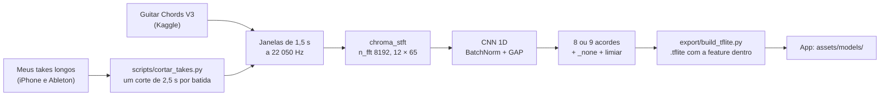

# ChordAI - Backend

[](https://github.com/imxder/ChordAI-backend/actions/workflows/ci.yml) [](https://sonarcloud.io/summary/new_code?id=imxder_ChordAI-backend)

Este é o pipeline de IA do ChordAI: aqui eu preparo os dados, treino a rede que reconhece acordes e exporto os modelos em TFLite que rodam dentro do app, no próprio celular.

App Flutter: [github.com/imxder/ChordAI](https://github.com/imxder/ChordAI)

---

## 1. Como funciona



- **Janela de 1,5 s**, o mesmo tamanho do trecho que o app grava.
- **Chroma**: quanto de cada uma das 12 notas tem em cada pedacinho da janela. É o que a rede olha.
- **CNN 1D** pequena, com BatchNorm e GlobalAveragePooling.
- **Classe `_none`** ("nenhum acorde"), treinada com ruído, percussão e acorde em volume baixo gerados pelo `pipeline.py`. No `v3_meu`, ela também aprende com os meus áudios de sem acorde e com sons de afinação sintéticos.
- **Limiar de confiança:** se a classe for `_none`, ou se a confiança ficar abaixo do limiar do modelo, o app mostra "desconhecido".
- **Silêncio:** janelas com RMS abaixo de 0,003 nem passam pelo modelo.
- **A feature vai dentro do `.tflite`.** O app manda o áudio bruto e recebe as probabilidades, sem calcular chroma em Dart. Por que a inferência saiu do servidor e foi pro aparelho está no [ADR 0001](docs/adr/0001-inferencia-no-aparelho.md).

O código comum ao treino, aos experimentos e à exportação fica em `pipeline.py`.

## 2. Os modelos do app

O app traz dois modelos em `assets/models/`, e eu escolho qual usar em **Perfil → Reconhecimento → Modelo no aparelho** ("Só v3" ou "v3 + meu dataset"). Por que são dois, e por que o padrão é o v3, está no [ADR 0002](docs/adr/0002-dois-modelos-no-app.md).

| | **v3** (padrão) | **v3_meu** |
|---|---|---|
| Experimento | C1, `aug2_chroma_stft8192_scalerfeat_gapbn_none`, seed 44 | F9, `F9_stft8192_aug2`, seed 43 |
| Dados de treino | pasta antiga `dataset/`: Training do V3 + 42 gravações antigas minhas | Training do V3 + o meu dataset (s1 e g1, sem os `take02`) |
| Acordes | Am, Bb, Bdim, C, Dm, Em, F e G | os 8 + A |
| Limiar | 0,50 | 0,55 |
| Release | [`model-v3`](https://github.com/imxder/ChordAI-backend/releases/tag/model-v3) | [`model-v3-meu`](https://github.com/imxder/ChordAI-backend/releases/tag/model-v3-meu) |

Fontes: o `model_info.json` de cada release, que é o mesmo de `assets/models/<modelo>/` no app.

- **Escolha da seed:** nos dois modelos, foi pela **validação**, nunca pelo teste. Treinei as seeds 42, 43 e 44 e fiquei com a de maior acurácia nos acordes da validação (`seed_selection` no `export_report.json` de cada release).
- **Tamanho:** cada `.tflite` float32 tem uns 420 KB (`size_kb_float32` no `export_report.json`). A maior parte é a STFT e a matriz de chroma, que vão dentro do arquivo.

### Resultados

| Teste | O que é | Janelas | v3 | v3_meu |
|---|---|---:|---:|---:|
| Sorteado da pasta antiga | 20% dos arquivos de `dataset/`, sorteados | 1545 | 95,3% | não se aplica |
| **Test do V3** | a pasta `dataset_kaggle/Test`: 10 pessoas e violões que não aparecem no treino | 1508 | **87,4%** | **85,7%** |
| `take02` | o meu `take02` de cada acorde, da mesma sessão do treino | 256 | 98,0% | 100,0% |
| Falso aceite, sem acorde gravado | meus takes de cordas abafadas e afinando | 48 | 81,2% | 22,9% |
| Falso aceite, sem acorde sintético | ruído, percussão e acorde em volume baixo | 260 | 1,9% | 1,5% |

Fontes:
- **v3:** `experiments/results/aug2_chroma_stft8192_scalerfeat_gapbn_none_s44/metrics.json` (sorteado) e `experiments/results_duas_fontes/0c/metrics.json` (os outros testes).
- **v3_meu:** `experiments/results_duas_fontes/F9_stft8192_aug2_s43/metrics.json`.
- **Tamanho dos testes:** `experiments/results_duas_fontes/comparativo.md`.
- As acurácias são sem limiar, só a classe de maior probabilidade, e contam só os 8 acordes do v3.

**Por que os números são tão diferentes:**

- **O teste sorteado tem as mesmas pessoas do treino.** Os arquivos de uma pessoa caem uns no treino e outros no teste, e o modelo já conhece o violão e o jeito dela tocar. Por isso o v3 dá 95,3% nele e 87,4% no Test do V3. O v3_meu treinou com o Training inteiro, então esse teste não serve pra ele.
- **O Test do V3 é o teste independente.** As 10 pessoas e violões dele não aparecem no treino. É o que mais se parece com um usuário novo, e é onde o v3 ganha: 87,4% contra 85,7%.
- **O `take02` é otimista.** Ele é da mesma sessão, dia, cômodo e microfone do treino. Serve pra comparar modelos, não pra prometer acerto. Não gravei a sessão `s3`, que seria o teste do meu violão em outras condições.
- **O falso aceite com sem acorde gravado é onde o v3_meu ganha.** O v3 mostra acorde em 81,2% dessas janelas, e o v3_meu em 22,9%. Mas **esse teste é pequeno**: são só 48 janelas (24 de cordas abafadas e 24 de afinando), da mesma sessão do resto do meu dataset.

## 3. Dados

Uso duas fontes, em pastas separadas que nunca se misturam em disco:

- **[Guitar Chords V3](https://www.kaggle.com/datasets/fabianavinci/guitar-chords-v3)**, da **Fabiana Vinci**, com licença **CC BY-SA 4.0**. Ela me autorizou por escrito, [num comentário do dataset](https://www.kaggle.com/datasets/fabianavinci/guitar-chords-v3/discussion/757671#3552939), a usar o dataset pra treinar, avaliar e distribuir os pesos no app gratuito, com crédito e link. Fica em `dataset_kaggle/Training` e `dataset_kaggle/Test`.
- **O meu dataset**, publicado no Kaggle como **[ChordAI Guitar Chords](https://www.kaggle.com/datasets/imxder/chordai-guitar-chords-v1)** (CC BY-SA 4.0). Fica em `dataset_proprio/<acorde>/`. Tem a sessão `s1` (violão no Gravador do iPhone 11), a `g1` (Tagima TW-61, estilo Jazzmaster, limpa pela GT-1; nos arquivos aparece como `jazzmaster`) e 42 gravações antigas. Como gravei está em [docs/roteiro-gravacao.md](docs/roteiro-gravacao.md).

O `data/sources.csv` tem uma linha por arquivo das duas fontes: caminho, acorde, fonte, instrumento, sessão, take, microfone e uso. As sessões estão em `data/sessoes.csv`.

A pasta antiga `dataset/` (o Training do V3 + as 42 gravações antigas) continua existindo porque o v3 e a API Flask foram treinados com ela.

**Licenças:** o **código** deste repositório é MIT ([LICENSE](LICENSE)). A licença MIT **não vale pros áudios**: o Guitar Chords V3 e o meu dataset continuam sendo CC BY-SA 4.0.

## 4. Como reproduzir

### Instalar

Python 3.11 ou superior. Os resultados foram gerados com o Python 3.12.10, librosa 1.0.0, TensorFlow 2.21.0 (Keras 3.15.1), NumPy 2.5.4, SciPy 1.18.1 e scikit-learn 1.9.1.

```bash
git clone https://github.com/imxder/ChordAI-backend.git
cd ChordAI-backend
python3 -m venv .venv
source .venv/bin/activate          # no Windows: .\.venv\Scripts\activate
pip install -r requirements.lock.txt
```

Uso o `requirements.lock.txt`, e não o `requirements.txt`, porque a exportação replica detalhes internos do librosa (a janela e o padding da STFT e o banco de filtros chroma), que mudam entre versões.

### Baixar os dados

Os três downloads funcionam sem login:

```bash
python baixar_dataset.py              # Guitar Chords V3 -> dataset_kaggle/
python baixar_dataset.py --proprio    # o meu dataset -> dataset_proprio/
python baixar_dataset.py --antigo     # a pasta antiga -> dataset/ (do Google Drive)
python -m scripts.montar_sources      # monta o data/sources.csv
```

### Treinar e exportar o v3

```bash
python -m experiments.run_seeds --only aug2_chroma_stft8192_scalerfeat_gapbn_none   # seeds 42, 43 e 44
python -m experiments.threshold --feature aug2_chroma_stft8192                      # limiar na validação
python export/build_tflite.py                                                      # escolhe a seed e exporta
```

### Treinar e exportar o v3_meu

```bash
python -m scripts.comparar_modelos --modelos F9 --feature chroma_stft8192 --aug 2   # seeds 42, 43 e 44
python export/build_tflite.py --duas-fontes F9_stft8192_aug2                         # escolhe a seed e exporta
```

O `build_tflite.py` sempre grava em `export/`, então exportar um modelo apaga o outro de lá. Por isso cada modelo exportado fica guardado numa GitHub Release. O treino é determinístico por seed: rodar de novo dá os mesmos pesos e as mesmas métricas.

Como o app usa os arquivos exportados está em [export/README.md](export/README.md).

### Testes

```bash
python -m pytest
```

O CI (`.github/workflows/ci.yml`) roda os mesmos testes em todo push e PR, com o Python 3.12.10 e o `requirements.lock.txt`, num passo pros testes e outro só pro export TFLite (`tests/unit/test_export_tflite.py`), que confere se o `.tflite` do `export/` dá as mesmas probabilidades do `example_expected.json`. Ele não tem os áudios, então pula os testes marcados com `dataset` (hoje nenhum precisa deles) e o do `afconvert`, que só existe no macOS.

## 5. Experimentos e histórico

- **Os experimentos de 15/11, com as duas fontes:** [docs/experimentos.md](docs/experimentos.md) explica cada sigla de `experiments/results_duas_fontes/` (0, R, A, B8, B11, F, F9, V3…), a ordem em que testei e por que o F9 virou o v3_meu.
- **Os experimentos antigos, só com a pasta `dataset/`:** estão em [`experiments/results/comparativo.md`](experiments/results/comparativo.md).

Como cheguei até aqui:

1. **Baseline do TCC:** 40 MFCC + CNN 1D com Flatten, **88,00% ± 0,94** no teste sorteado (média das seeds 42, 43 e 44, `experiments/results/comparativo.md`).
2. **Correção do split.** O modelo antigo (`experiments/candidates/candidate_91_81/`) dava **96,89%** no `experiments/evaluate_realtime.py`. Esse número não ficou salvo em arquivo, só no README antigo. Ele não valia: o split dependia da ordem do `os.listdir()` e colocava no treino arquivos que estavam no teste. Com o split por arquivo, na lista ordenada, e uma validação separada, o mesmo pipeline dá os **88%** do baseline. O `python -m experiments.split_hash --check` confere se o split continua o mesmo.
3. **Chroma no lugar de MFCC:** **+7,75 ± 0,78** pontos (`experiments/results/comparativo.md`, "Efeitos isolados"). Foi a mudança que mais fez diferença. O scaler por feature, o augmentation e a CNN 2D não tiveram efeito significativo.
4. **CNN menor:** o GAP+BN custou uns 0,6 ponto e deixou a rede 5,5× menor (de 259 mil pra 47 mil parâmetros). Convertida sozinha pra TFLite, essa CNN tem 188 KB (coluna "TFLite (KB)" do mesmo comparativo).
5. **Classe `_none` e limiar de confiança:** a rede aprende a dizer "nenhum acorde", e o limiar é calibrado na validação. Os números estão na seção "Parte 5" do comparativo.
6. **Feature dentro do TFLite:** troquei a chroma_cqt pela chroma_stft com n_fft 8192 + augmentation (o C1), que custou uns 0,3 ponto (−0,28 ± 0,88 na seção "Parte 7a" do comparativo). O motivo está no [ADR 0001](docs/adr/0001-inferencia-no-aparelho.md). Esse é o v3 do app.
7. **Escolha da seed pela validação:** entre as seeds 42, 43 e 44, a de maior acurácia nos acordes da validação. O teste não participa (`export/build_tflite.py`).
8. **As duas fontes:** o v3_meu, em [docs/experimentos.md](docs/experimentos.md).

Para reproduzir o baseline sem mexer em nada: `python -m experiments.run_seeds --only feat_mfcc`.

Os pesos (`.h5`) dos experimentos não ficam no Git. Ficam só os `metrics.json`, as matrizes de confusão, os relatórios e os `comparativo.md`. Como o treino é determinístico por seed, `python -m experiments.run_seeds` gera os mesmos pesos de novo.

## 6. API Flask (ferramenta de desenvolvimento)

**A API Flask não usa nenhum dos modelos do app.** Ela carrega o `trained_model/`, um modelo mais antigo, com a chroma_cqt calculada no servidor:

| | API Flask |
|---|---|
| Experimento | `feat_chroma_scalerfeat_gapbn_none`, seed 42 |
| Dados de treino | a pasta antiga `dataset/` |
| Acordes | os 8 do v3 + `_none` |
| Limiar | 0,50 |
| Arquivo | `trained_model/model.h5` |
| Sorteado da pasta antiga | 95,6% |
| Test do V3 | 90,7% |
| Falso aceite, sem acorde gravado | 87,5% |

Fontes: `trained_model/model_config.json` e `metrics.json`, e `experiments/results_duas_fontes/0/metrics.json`.

Uso a API no modo "servidor" do app, que é uma opção avançada em Perfil → Reconhecimento. A página web que existia na rota `/` saiu: o app substituiu ela.

```bash
python -m api.app
```

**Porta:** por padrão, a API sobe na **5000** (o `api/app.py` usa o padrão do Flask, e o `api/serve.py` sobe o waitress na 5000). No Mac, eu rodo na **5001**, porque o AirPlay do macOS ocupa a 5000:

```bash
flask --app api.app run --host 0.0.0.0 --port 5001
```

No app, o endereço vai em Perfil → Reconhecimento: o IP do computador e a porta, ou o nome dele na rede, como `meu-mac.local:5001`.

O modo debug do Flask fica desligado. Pra ligar, rode com `FLASK_DEBUG=1`. Ele mostra o código e deixa rodar comandos pela página de erro, e a API fica aberta na rede, então só uso quando estou mexendo nela.

### `POST /predict_chord`

Recebe um WAV no campo `audio` (multipart/form-data) e devolve:

```json
{ "status": "ok", "chord": "C", "confidence": 0.98 }
```

O `status` pode ser `ok`, `silence`, `too_short` ou `unknown`. Nos três últimos, `chord` vem `null`.

### Deixar rodando no Windows

O `api/serve.py` sobe a API com waitress, sem janela, e grava a saída em `server.log`, na raiz:

```bash
python -m api.serve
```

Pra iniciar sozinho ao fazer login, crie uma tarefa no Agendador de Tarefas (PowerShell):

```powershell
$dir = "C:\caminho\para\ChordAI-backend"
$action = New-ScheduledTaskAction -Execute "$dir\.venv\Scripts\pythonw.exe" -Argument "-m api.serve" -WorkingDirectory $dir
$trigger = New-ScheduledTaskTrigger -AtLogOn -User $env:USERNAME
$settings = New-ScheduledTaskSettingsSet -AllowStartIfOnBatteries -DontStopIfGoingOnBatteries -ExecutionTimeLimit 0 -RestartCount 3 -RestartInterval (New-TimeSpan -Minutes 1)
Register-ScheduledTask -TaskName "VIOLAO_AI Server" -Action $action -Trigger $trigger -Settings $settings -Force
Start-ScheduledTask -TaskName "VIOLAO_AI Server"
```

Pra treinar de novo o modelo da API: `python train_model.py`. Ele lê a pasta `dataset/`, sorteia treino, validação e teste, calibra o limiar e grava em `trained_model/`. Com a seed 42, reproduz o mesmo modelo.

## 7. Estrutura dos arquivos

```
/
├── README.md
├── LICENSE                     # MIT, só para o código
├── pipeline.py                 # código comum: janelas, features, split, modelos, _none, limiar
├── train_model.py              # treina o modelo da API Flask (trained_model/)
├── baixar_dataset.py           # baixa o V3, o meu dataset e a pasta antiga
├── requirements.txt
├── requirements.lock.txt       # versões exatas usadas nos resultados
├── pytest.ini                  # o marcador "dataset" dos testes que precisam dos áudios
├── .github/workflows/ci.yml    # roda o pytest e confere o export em todo push e PR
│
├── api/
│   ├── app.py                  # API Flask: só o POST /predict_chord (ferramenta de desenvolvimento)
│   └── serve.py                # sobe a API com waitress (Windows)
├── data/
│   ├── sources.csv             # uma linha por arquivo de áudio das duas fontes
│   └── sessoes.csv             # as sessões em que gravei o meu dataset
├── docs/
│   ├── experimentos.md         # as siglas e as rodadas de 15/11
│   ├── roteiro-gravacao.md     # como gravei o meu dataset
│   └── adr/
│       ├── 0001-inferencia-no-aparelho.md
│       └── 0002-dois-modelos-no-app.md
├── scripts/
│   ├── cortar_takes.py         # corta os takes longos em um arquivo por batida
│   ├── exportar_ableton.py     # exporta os takes de um projeto do Ableton
│   ├── montar_sources.py       # monta o data/sources.csv
│   ├── dividir_treino.py       # treino, validação e testes a partir do sources.csv
│   ├── comparar_modelos.py     # treina e compara os modelos com as duas fontes
│   └── fontes.py               # lista de acordes, pastas e formato do sources.csv
├── export/
│   ├── build_tflite.py         # exporta para TFLite com a feature dentro
│   ├── README.md               # como o app usa os arquivos exportados
│   └── ...                     # o último modelo exportado (hoje o v3_meu)
├── experiments/
│   ├── results/                # experimentos com a pasta antiga (comparativo.md)
│   ├── results_duas_fontes/    # experimentos de 15/11 (comparativo.md)
│   ├── candidates/             # modelos antigos que os testes e o equivalence_check usam
│   ├── legado/                 # experimentos de treino de outubro (class weight e ensemble)
│   ├── evaluate_realtime.py    # acurácia e latência em janelas como as do app
│   ├── confusion_report.py     # matriz de confusão e relatório por acorde
│   └── audio_capture.py        # captura de áudio do microfone (o tamanho da janela vem daqui)
├── tests/                      # pytest
├── trained_model/              # o modelo da API Flask
│
├── dataset/                    # pasta antiga (não vai pro Git)
├── dataset_kaggle/             # Guitar Chords V3 (não vai pro Git)
├── dataset_proprio/            # o meu dataset (não vai pro Git)
└── gravacoes/                  # os takes longos antes de cortar (não vai pro Git)
```
