# Como o backend funciona

Este documento descreve o caminho do áudio até o modelo que roda no celular, e o que cada pasta do repositório faz. O que está no código vem com o arquivo. Os números são de arquivos do repositório, e cada um indica de qual.

## O pipeline, do dado ao app

```mermaid
flowchart LR
    D["Dados<br/>V3 (Kaggle) + dataset próprio"] --> S["Divisão<br/>treino, validação e teste"]
    S --> J["Janelas de 1,5 s<br/>22 050 Hz"]
    J --> A["Augmentation<br/>e classe _none"]
    A --> F["chroma_stft 8192<br/>12 × 65"]
    F --> R["CNN 1D<br/>GAP + BatchNorm"]
    R --> V["Avaliação e limiar<br/>na validação"]
    V --> E["export/build_tflite.py<br/>.tflite com a feature dentro"]
    E --> G["Release no GitHub<br/>model-v3 e model-v3-meu"]
    G --> P["App: assets/models/"]
```

| Passo | O que faz | Arquivo |
|---|---|---|
| 1. Dados | duas fontes em pastas separadas, e um CSV com uma linha por áudio (caminho, acorde, fonte, sessão, take, uso) | `baixar_dataset.py`, `scripts/montar_sources.py`, `data/sources.csv`, `data/sessoes.csv` |
| 2. Cortar os takes próprios | corta cada take longo em um arquivo de 2,5 s por batida | `scripts/cortar_takes.py` |
| 3. Divisão | separa treino, validação e teste por arquivo. O Test do V3 já vem separado: são pessoas e violões que não estão no treino | `scripts/dividir_treino.py` (duas fontes) e `pipeline.py`: `split_dataset_files` e `split_train_val` (pasta antiga) |
| 4. Janelas | cada arquivo vira janelas de 1,5 s, com salto de 0,75 s e no máximo 8 por arquivo | `pipeline.py`: `make_windowed_segments`, `WINDOW_SECONDS`, `CROP_HOP_SECONDS`, `MAX_CROPS_PER_FILE` |
| 5. Augmentation | no treino, cada janela de acorde ganha 2 versões com ruído, ganho, passa-banda e deslocamento (`aug2`) | `experiments/augment.py` |
| 6. Classe `_none` | a rede aprende a dizer "nenhum acorde" com ruído, percussão e acorde em volume baixo gerados por código | `pipeline.py`: `_gen_noise`, `_gen_percussion`, `_gen_low_volume`, `build_negatives` |
| 7. Chroma | cada janela vira uma matriz 12 notas × 65 quadros (chroma_stft com n_fft 8192) | `pipeline.py`: `extract_chroma_stft8192` e as constantes `CHROMA_STFT_*` |
| 8. Treino | CNN 1D com BatchNorm e GlobalAveragePooling, parada antecipada pela validação | `pipeline.py`: `build_gap_bn_cnn` e `training_callbacks` |
| 9. Limiar | o limiar de confiança é o que dá a maior cobertura com no máximo 5% de falso aceite e acurácia mínima de 98% nos aceitos, medido na validação | `pipeline.py`: `choose_threshold`, `experiments/threshold.py` |
| 10. Escolha da seed | de 3 seeds (42, 43 e 44), fica a de maior acurácia na validação. O teste não participa | `export/build_tflite.py`: `choose_seed` |
| 11. Exportação | junta chroma, scaler e CNN num grafo só e converte para TFLite | `export/build_tflite.py`: `EndToEnd` |
| 12. Release | cada modelo exportado fica numa GitHub Release, porque o `export/` guarda só o último | [`model-v3`](https://github.com/imxder/ChordAI-backend/releases/tag/model-v3) e [`model-v3-meu`](https://github.com/imxder/ChordAI-backend/releases/tag/model-v3-meu) |

### Por que cada decisão

- Janela de 1,5 s. É o tamanho do trecho que o app guarda e manda para o modelo (`WINDOW_SECONDS` aqui e `input_samples` no `model_info.json`, 33 075 amostras a 22 050 Hz).
- Chroma no lugar de MFCC. O chroma mostra quanto de cada uma das 12 notas há na janela, que é o que distingue um acorde de outro. Foi a mudança que mais fez diferença: +7,75 ± 0,78 pontos (`experiments/results/comparativo.md`, "Efeitos isolados").
- CNN pequena. O GAP + BatchNorm custou uns 0,6 ponto e deixou a rede 5,5 vezes menor, de 259 mil para 47 mil parâmetros (README, seção 5, item 4). Ela roda no celular sem pesar.
- Seed escolhida pela validação. Se a escolha fosse pelo teste, o número do teste ficaria otimista. Por isso o `choose_seed` nem lê os arquivos de teste.
- Teste de outras pessoas. O Test do V3 tem 10 pessoas e violões que não aparecem no treino. É o teste que mais se parece com alguém novo usando o app (ADR 0002).
- Split por arquivo. Antes o split dependia da ordem do `os.listdir()` e colocava arquivos do teste no treino. O `python -m experiments.split_hash --check` confere se o split continua o mesmo (README, seção 5, item 2).

## A ligação com o app

O `.tflite` já leva a chroma dentro. O app manda o áudio bruto (`float32 [1, 33075]`, que é o PCM de 16 bits dividido por 32768) e recebe as probabilidades (`float32 [1, 9]` no v3 e `[1, 10]` no v3_meu, na ordem do `labels.json`). Não existe chroma, FFT nem MFCC em Dart. O motivo está no [ADR 0001](adr/0001-inferencia-no-aparelho.md).

Para isso funcionar, o `EndToEnd` do `export/build_tflite.py` refaz em TensorFlow o que o librosa faz: a janela de Hann, o padding de zeros, o espectrograma de potência, o banco de filtros chroma e a normalização pelo máximo de cada quadro. A exportação confere a equivalência com o librosa em 200 janelas (`export/export_report.json`, `equivalence`):

- erro máximo na feature: 1,07e-6;
- erro máximo nas probabilidades: 7,7e-7;
- `class_agreement`: 1,0.

Por isso o `requirements.lock.txt` fixa o librosa em 1.0.0 e o TensorFlow em 2.21.0: o librosa muda esses detalhes entre versões.

Do lado do app, o `model_info.json` de cada modelo diz o limiar de confiança (0,50 no v3 e 0,55 no v3_meu), o limiar de silêncio (RMS 0,003) e o sha256 do `.tflite`. O app confere esse hash no CI (`tool/conferir_modelos.py`, no repositório do app).

## O que cada passo gera e para onde vai

| Arquivo | O que é | Quem gera | Para onde vai |
|---|---|---|---|
| `model.h5`, `encoder.joblib`, `scaler.joblib` | a rede treinada, as classes e o scaler | `train_model.py`, `scripts/comparar_modelos.py`, `experiments/run_seeds.py` | `trained_model/` (API Flask) ou `experiments/results*/`. Os `.h5` dos experimentos não ficam no Git |
| `metrics.json` | acurácia, falso aceite e matriz de cada teste | os mesmos | fica no Git, em `experiments/results*/` |
| `chord_model.tflite` | o modelo do celular, em float32 (uns 420 KB) | `export/build_tflite.py` | release do GitHub, e de lá para o `assets/models/<modelo>/` do app |
| `chord_model_int8.tflite` | o mesmo com a CNN em int8 (uns 289 KB), só como alternativa | `export/build_tflite.py` | release |
| `labels.json` | a ordem das classes na saída, com o `_none` | `export/build_tflite.py` | release e app |
| `model_info.json` | taxa de amostragem, tamanho da entrada, limiares, sha256 e a descrição da feature | `export/build_tflite.py` | release e app |
| `export_report.json` | equivalência, operações do grafo, tamanhos, latência e escolha da seed | `export/build_tflite.py` | só no repositório |
| `example.wav` e `example_expected.json` | uma janela de teste e as probabilidades esperadas | `export/build_tflite.py` | release e app (o teste de equivalência do app usa) |

O `build_tflite.py` sempre grava em `export/`, então exportar um modelo apaga o outro de lá. Por isso cada modelo exportado fica guardado na própria release.

## Pasta → papel

| Pasta ou arquivo | Papel |
|---|---|
| `pipeline.py` | o código comum: janelas, features, split, redes, classe `_none`, limiar e o `model_config.json` |
| `train_model.py` | treina o modelo da API Flask (`trained_model/`) com a pasta antiga `dataset/` |
| `baixar_dataset.py` | baixa o Guitar Chords V3, o dataset próprio e a pasta antiga |
| `scripts/` | tudo que prepara os dados e roda as comparações: cortar takes, exportar do Ableton, montar o `sources.csv`, dividir treino e teste e comparar modelos com as duas fontes |
| `experiments/` | os experimentos: cada feature, augmentation e arquitetura testada, o `run_seeds.py`, a escolha do limiar, as avaliações e os resultados (`results/` e `results_duas_fontes/`) |
| `export/` | a exportação para TFLite e o último modelo exportado (hoje o v3_meu) |
| `api/` | a API Flask (`POST /predict_chord`). É ferramenta de experimento: usa o `trained_model/` e o app não fala com ela |
| `tests/` | o pytest, com `sintetico.py` gerando acordes de teste |
| `data/` | o `sources.csv` e o `sessoes.csv` |
| `docs/` | este documento, os experimentos, o roteiro de gravação, os testes e os ADRs |
| `dataset/`, `dataset_kaggle/`, `dataset_proprio/`, `gravacoes/` | os áudios. Não vão para o Git |

## O que o pipeline não faz

- Não existe um teste do violão em outras condições. A sessão `s3` não foi gravada. Os `take02` são da mesma sessão do treino, então o número deles sai otimista (ADR 0002).
- O teste de sem acorde gravado é pequeno: 48 janelas, da mesma sessão do resto do dataset próprio (ADR 0002).
- O teste de latência é no computador. Os 8,78 ms do `export_report.json` (`latency_ms_tflite_1thread`, float32) são do computador de desenvolvimento com 1 thread. No celular ainda não foi medido.
- Os modelos estão congelados. Os modelos não foram retreinados nem recalibrados depois da exportação.
