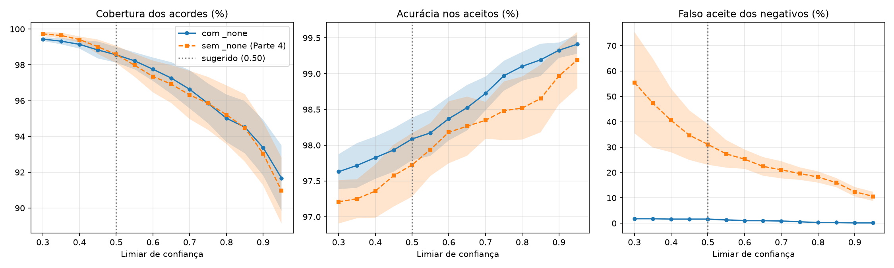

# Limiar de confiança — ChordAI (Parte 5)

Teste: 1485 janelas de acorde que passam pelo filtro de silêncio (de 1545; 60 têm RMS < 0.003 e o app já devolve "silence") + 223 janelas negativas (low_volume: 75, noise: 74, percussion: 74). Média ± desvio sobre as seeds 42, 43, 44. Valores em %.

"Útil" = janelas de acorde aceitas **e** certas (cobertura × acurácia). "Falso aceite" = negativas aceitas como algum acorde. Colunas "degr." = mesmo teste de acordes com ruído rosa a 15 dB + passa-banda 200 Hz–5 kHz.

**Sugestão:** maior cobertura com falso aceite <= 5% e acuracia >= 98% (modelo feat_chroma_scalerfeat_gapbn_none, teste limpo, media das seeds) → limiar **0.5**.

## Com classe _none (`feat_chroma_scalerfeat_gapbn_none`)

| Limiar | Cobertura | Acurácia nos aceitos | Útil | Falso aceite | Cobertura (degr.) | Acurácia (degr.) |
|---:|---:|---:|---:|---:|---:|---:|
| 0.30 | 99.4 ± 0.1 | 97.6 ± 0.2 | 97.1 ± 0.3 | 1.8 ± 0.0 | 98.0 ± 0.4 | 96.7 ± 0.4 |
| 0.35 | 99.3 ± 0.2 | 97.7 ± 0.3 | 97.1 ± 0.3 | 1.8 ± 0.0 | 98.0 ± 0.4 | 96.7 ± 0.5 |
| 0.40 | 99.1 ± 0.2 | 97.8 ± 0.3 | 97.0 ± 0.4 | 1.6 ± 0.3 | 97.9 ± 0.5 | 96.8 ± 0.4 |
| 0.45 | 98.8 ± 0.5 | 97.9 ± 0.3 | 96.8 ± 0.5 | 1.6 ± 0.3 | 97.4 ± 0.7 | 97.1 ± 0.4 |
| 0.50 **←** | 98.6 ± 0.4 | 98.1 ± 0.3 | 96.7 ± 0.5 | 1.6 ± 0.3 | 97.2 ± 0.9 | 97.2 ± 0.5 |
| 0.55 | 98.2 ± 0.5 | 98.2 ± 0.3 | 96.4 ± 0.5 | 1.3 ± 0.4 | 96.7 ± 1.0 | 97.5 ± 0.5 |
| 0.60 | 97.8 ± 0.7 | 98.4 ± 0.3 | 96.2 ± 0.5 | 1.0 ± 0.3 | 96.2 ± 1.0 | 97.6 ± 0.5 |
| 0.65 | 97.3 ± 0.9 | 98.5 ± 0.3 | 95.8 ± 0.6 | 1.0 ± 0.3 | 95.7 ± 1.2 | 97.9 ± 0.6 |
| 0.70 | 96.6 ± 1.1 | 98.7 ± 0.2 | 95.4 ± 0.9 | 0.9 ± 0.4 | 94.8 ± 1.4 | 98.1 ± 0.5 |
| 0.75 | 95.8 ± 1.1 | 99.0 ± 0.2 | 94.9 ± 1.0 | 0.6 ± 0.3 | 94.0 ± 1.8 | 98.3 ± 0.5 |
| 0.80 | 95.0 ± 1.3 | 99.1 ± 0.2 | 94.2 ± 1.3 | 0.3 ± 0.3 | 93.4 ± 2.0 | 98.4 ± 0.4 |
| 0.85 | 94.5 ± 1.5 | 99.2 ± 0.2 | 93.8 ± 1.4 | 0.3 ± 0.3 | 92.3 ± 2.1 | 98.5 ± 0.4 |
| 0.90 | 93.4 ± 1.6 | 99.3 ± 0.1 | 92.7 ± 1.5 | 0.1 ± 0.3 | 91.0 ± 2.2 | 98.7 ± 0.3 |
| 0.95 | 91.7 ± 1.8 | 99.4 ± 0.1 | 91.1 ± 1.9 | 0.1 ± 0.3 | 88.8 ± 2.4 | 99.0 ± 0.4 |

## Sem classe _none (`feat_chroma_scalerfeat_gapbn`, Parte 4)

| Limiar | Cobertura | Acurácia nos aceitos | Útil | Falso aceite | Cobertura (degr.) | Acurácia (degr.) |
|---:|---:|---:|---:|---:|---:|---:|
| 0.30 | 99.7 ± 0.1 | 97.2 ± 0.3 | 96.9 ± 0.3 | 55.5 ± 20.0 | 99.6 ± 0.2 | 96.2 ± 0.4 |
| 0.35 | 99.6 ± 0.2 | 97.3 ± 0.3 | 96.9 ± 0.3 | 47.4 ± 17.5 | 99.3 ± 0.2 | 96.3 ± 0.4 |
| 0.40 | 99.4 ± 0.2 | 97.4 ± 0.4 | 96.8 ± 0.2 | 40.5 ± 12.5 | 98.9 ± 0.4 | 96.5 ± 0.5 |
| 0.45 | 99.0 ± 0.4 | 97.6 ± 0.4 | 96.6 ± 0.0 | 34.7 ± 9.7 | 98.6 ± 0.6 | 96.7 ± 0.7 |
| 0.50 | 98.6 ± 0.5 | 97.7 ± 0.4 | 96.3 ± 0.0 | 31.1 ± 8.0 | 98.2 ± 0.6 | 96.8 ± 0.6 |
| 0.55 | 98.0 ± 0.6 | 97.9 ± 0.4 | 96.0 ± 0.3 | 27.4 ± 5.4 | 97.5 ± 0.8 | 97.1 ± 0.5 |
| 0.60 | 97.4 ± 0.9 | 98.2 ± 0.4 | 95.6 ± 0.5 | 25.3 ± 3.8 | 96.9 ± 1.0 | 97.2 ± 0.5 |
| 0.65 | 96.9 ± 1.1 | 98.3 ± 0.4 | 95.2 ± 0.6 | 22.4 ± 3.7 | 96.2 ± 1.1 | 97.4 ± 0.5 |
| 0.70 | 96.3 ± 1.3 | 98.3 ± 0.3 | 94.7 ± 1.1 | 21.1 ± 3.4 | 95.5 ± 1.1 | 97.7 ± 0.3 |
| 0.75 | 95.8 ± 1.5 | 98.5 ± 0.4 | 94.4 ± 1.1 | 19.6 ± 2.5 | 94.9 ± 1.3 | 97.8 ± 0.3 |
| 0.80 | 95.2 ± 1.6 | 98.5 ± 0.4 | 93.8 ± 1.2 | 18.2 ± 2.2 | 94.0 ± 1.3 | 98.0 ± 0.4 |
| 0.85 | 94.5 ± 1.9 | 98.7 ± 0.5 | 93.2 ± 1.5 | 16.0 ± 1.8 | 93.0 ± 1.4 | 98.1 ± 0.4 |
| 0.90 | 93.0 ± 1.8 | 99.0 ± 0.4 | 92.1 ± 1.4 | 12.4 ± 1.9 | 92.0 ± 1.5 | 98.3 ± 0.2 |
| 0.95 | 91.0 ± 1.8 | 99.2 ± 0.4 | 90.2 ± 1.5 | 10.6 ± 1.8 | 90.2 ± 1.7 | 98.6 ± 0.1 |
