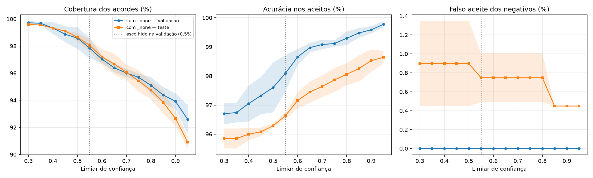

# Limiar de confiança — ChordAI (`feat_chroma_stft8192_scalerfeat_gapbn_none`)

- **Validação** (usada para ESCOLHER o limiar): 944 janelas de acorde (de 985; 41 com RMS < 0.003, para as quais o app já devolve "silence") + 133 negativas (low_volume: 45, noise: 44, percussion: 44).
- **Teste** (só REPORTADO, não participa da escolha): 1485 janelas de acorde (de 1545; 60 com RMS < 0.003, para as quais o app já devolve "silence") + 223 negativas (low_volume: 75, noise: 74, percussion: 74).
- Média ± desvio sobre as seeds 42, 43, 44. Valores em %.

"Útil" = janelas de acorde aceitas **e** certas (cobertura × acurácia). "Falso aceite" = negativas aceitas como algum acorde. Colunas "degr." = mesmo teste de acordes com ruído rosa a 15 dB + passa-banda 200 Hz–5 kHz.

**Limiar escolhido na validação: 0.55** — critério: maior cobertura com falso aceite <= 5% e acuracia nos aceitos >= 98% (modelo feat_chroma_stft8192_scalerfeat_gapbn_none, media das seeds [42, 43, 44]).

| No limiar escolhido | Cobertura | Acurácia nos aceitos | Útil | Falso aceite |
|---|---:|---:|---:|---:|
| Validação (escolha) | 97.8 ± 0.7 | 98.1 ± 0.6 | 96.0 ± 0.3 | 0.0 ± 0.0 |
| Teste (reportado) | 98.0 ± 0.4 | 96.6 ± 0.1 | 94.7 ± 0.3 | 0.7 ± 0.3 |

No teste degradado, com o mesmo limiar: cobertura 94.9%, acurácia nos aceitos 96.0%.

**Limiar de cada seed** (escolhido na validação da própria seed, mesmo critério; é assim que o modelo de produção é calibrado): seed 42: 0.45, seed 43: 0.60, seed 44: 0.60. No teste, cada seed no seu limiar: cobertura 97.6 ± 1.3, acurácia nos aceitos 96.9 ± 0.7, falso aceite 0.7 ± 0.3.

## Com classe _none (`feat_chroma_stft8192_scalerfeat_gapbn_none`) — validação (escolha)

| Limiar | Cobertura | Acurácia nos aceitos | Útil | Falso aceite |
|---:|---:|---:|---:|---:|
| 0.30 | 99.7 ± 0.1 | 96.7 ± 0.4 | 96.4 ± 0.2 | 0.0 ± 0.0 |
| 0.35 | 99.7 ± 0.1 | 96.7 ± 0.3 | 96.4 ± 0.2 | 0.0 ± 0.0 |
| 0.40 | 99.3 ± 0.4 | 97.1 ± 0.6 | 96.4 ± 0.2 | 0.0 ± 0.0 |
| 0.45 | 98.9 ± 0.6 | 97.3 ± 0.6 | 96.2 ± 0.1 | 0.0 ± 0.0 |
| 0.50 | 98.6 ± 0.8 | 97.6 ± 0.9 | 96.2 ± 0.1 | 0.0 ± 0.0 |
| 0.55 **←** | 97.8 ± 0.7 | 98.1 ± 0.6 | 96.0 ± 0.3 | 0.0 ± 0.0 |
| 0.60 | 97.0 ± 0.3 | 98.7 ± 0.3 | 95.7 ± 0.2 | 0.0 ± 0.0 |
| 0.65 | 96.4 ± 0.3 | 99.0 ± 0.2 | 95.4 ± 0.2 | 0.0 ± 0.0 |
| 0.70 | 96.0 ± 0.3 | 99.1 ± 0.2 | 95.1 ± 0.2 | 0.0 ± 0.0 |
| 0.75 | 95.7 ± 0.3 | 99.1 ± 0.1 | 94.8 ± 0.2 | 0.0 ± 0.0 |
| 0.80 | 95.1 ± 0.6 | 99.3 ± 0.2 | 94.4 ± 0.4 | 0.0 ± 0.0 |
| 0.85 | 94.4 ± 0.6 | 99.5 ± 0.2 | 93.9 ± 0.4 | 0.0 ± 0.0 |
| 0.90 | 93.9 ± 0.6 | 99.6 ± 0.1 | 93.5 ± 0.5 | 0.0 ± 0.0 |
| 0.95 | 92.6 ± 1.1 | 99.8 ± 0.1 | 92.4 ± 1.0 | 0.0 ± 0.0 |

## Com classe _none (`feat_chroma_stft8192_scalerfeat_gapbn_none`) — teste (reportado)

| Limiar | Cobertura | Acurácia nos aceitos | Útil | Falso aceite | Cobertura (degr.) | Acurácia (degr.) |
|---:|---:|---:|---:|---:|---:|---:|
| 0.30 | 99.6 ± 0.0 | 95.9 ± 0.3 | 95.5 ± 0.3 | 0.9 ± 0.4 | 96.7 ± 0.2 | 95.1 ± 0.6 |
| 0.35 | 99.6 ± 0.0 | 95.9 ± 0.3 | 95.4 ± 0.4 | 0.9 ± 0.4 | 96.7 ± 0.2 | 95.1 ± 0.6 |
| 0.40 | 99.3 ± 0.1 | 96.0 ± 0.2 | 95.4 ± 0.3 | 0.9 ± 0.4 | 96.6 ± 0.1 | 95.2 ± 0.5 |
| 0.45 | 99.1 ± 0.0 | 96.1 ± 0.1 | 95.2 ± 0.2 | 0.9 ± 0.4 | 96.3 ± 0.1 | 95.3 ± 0.4 |
| 0.50 | 98.7 ± 0.3 | 96.3 ± 0.1 | 95.0 ± 0.3 | 0.9 ± 0.4 | 95.7 ± 0.2 | 95.6 ± 0.4 |
| 0.55 **←** | 98.0 ± 0.4 | 96.6 ± 0.1 | 94.7 ± 0.3 | 0.7 ± 0.3 | 94.9 ± 0.4 | 96.0 ± 0.3 |
| 0.60 | 97.2 ± 0.6 | 97.2 ± 0.3 | 94.4 ± 0.3 | 0.7 ± 0.3 | 93.9 ± 0.7 | 96.4 ± 0.2 |
| 0.65 | 96.7 ± 0.8 | 97.4 ± 0.4 | 94.2 ± 0.4 | 0.7 ± 0.3 | 93.1 ± 0.4 | 96.9 ± 0.2 |
| 0.70 | 96.1 ± 0.6 | 97.6 ± 0.4 | 93.8 ± 0.2 | 0.7 ± 0.3 | 92.4 ± 0.4 | 97.2 ± 0.2 |
| 0.75 | 95.4 ± 0.8 | 97.9 ± 0.4 | 93.4 ± 0.4 | 0.7 ± 0.3 | 91.5 ± 0.4 | 97.5 ± 0.1 |
| 0.80 | 94.7 ± 0.7 | 98.1 ± 0.4 | 92.9 ± 0.3 | 0.7 ± 0.3 | 90.4 ± 0.5 | 97.7 ± 0.2 |
| 0.85 | 93.8 ± 0.8 | 98.3 ± 0.5 | 92.2 ± 0.5 | 0.4 ± 0.0 | 89.6 ± 0.5 | 97.9 ± 0.2 |
| 0.90 | 92.7 ± 0.5 | 98.5 ± 0.4 | 91.3 ± 0.2 | 0.4 ± 0.0 | 88.3 ± 0.7 | 98.2 ± 0.1 |
| 0.95 | 90.9 ± 0.5 | 98.6 ± 0.2 | 89.7 ± 0.6 | 0.4 ± 0.0 | 85.9 ± 0.6 | 98.8 ± 0.3 |
